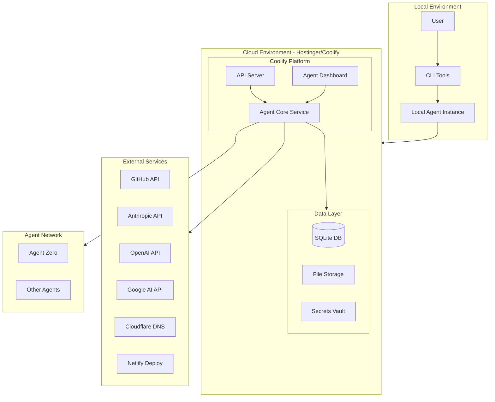
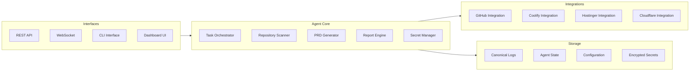
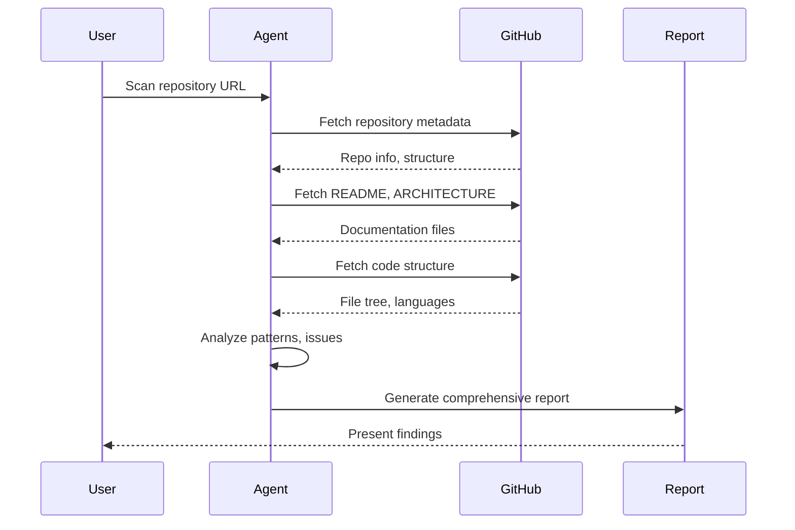
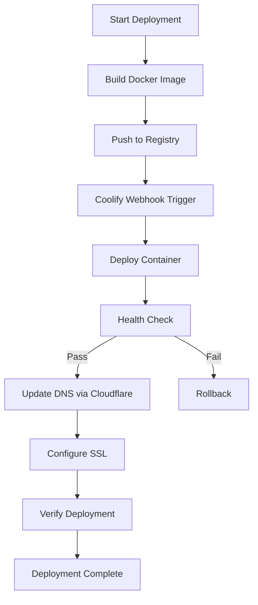

# GitHub Agent Secretary - Self-Architecture Document

## Executive Summary

This document defines the complete architecture for a GitHub Agent Secretary capable of:
- Analyzing and reporting on multiple repositories
- Creating PRDs through collaborative discussion
- Self-hosting on Hostinger via Coolify
- Integrating with agent dashboards and operating systems
- Managing secrets securely across cloud and local environments
- Working as a liaison between multiple agents and repos

---

## Part 1: My Capabilities Assessment

### What I CAN Do

#### Code Analysis & Generation
- Read, write, and modify code across multiple programming languages
- Analyze repository structures and architectures
- Generate comprehensive documentation and PRDs
- Create and modify configuration files

#### Repository Operations
- Clone and explore repositories
- Analyze codebases for patterns, issues, and improvements
- Generate reports on repository health and structure
- Create branches and propose changes (via PR descriptions)

#### Multi-Model LLM Support
- Claude 3 (Opus, Sonnet, Haiku)
- GPT-4, GPT-3.5
- Gemini (1.0 Pro, 1.5 Flash, 1.5 Pro)
- Mistral (7b, 8x7b, Medium, Small, Large)
- Groq (LLAMA3, LLAMA2, Mixtral, GEMMA)
- Local LLMs via Ollama
- LM Studio

#### Browser Automation
- Web browsing and scraping via Playwright
- Screenshot capture and analysis
- Form interaction and navigation
- Content extraction (text, markdown, PDF)

#### Project Management
- Create and manage projects
- Track conversation history
- Maintain agent state across sessions
- Generate and export project documentation

#### Deployment Services
- Netlify integration for static deployments
- Docker containerization support
- Coolify deployment capability

### What I CANNOT Do (Without External Tools)

#### Direct GitHub Operations
- Cannot directly push commits to repositories
- Cannot create pull requests directly
- Cannot manage GitHub Issues or Projects directly
- Cannot trigger GitHub Actions directly

#### Direct Cloud Operations
- Cannot directly provision cloud resources
- Cannot directly configure DNS settings
- Cannot directly manage SSL certificates

#### Real-Time Communication
- Cannot initiate real-time notifications
- Cannot send emails or messages proactively
- Cannot create webhooks without API access

### What I NEED To Function Fully

1. **GitHub PAT with proper scopes** - For repo operations
2. **Cloud API tokens** - For deployment operations
3. **Dashboard integration endpoint** - For reporting
4. **Webhook endpoints** - For inter-agent communication
5. **Persistent storage** - For canonical logs and state

---

## Part 2: System Architecture

### High-Level Architecture



### Component Architecture



---

## Part 3: Secrets Management System

### Architecture Principles

1. **Never commit secrets to Git** - All secrets stored in encrypted vault
2. **Environment-based injection** - Secrets loaded at runtime
3. **Scope-limited tokens** - Each token has minimum required permissions
4. **Rotation support** - System supports secret rotation without code changes
5. **Audit logging** - All secret access is logged

### Secrets Storage Structure

```
/secrets/
├── .vault/                    # Encrypted secrets storage
│   ├── api_keys.enc          # Encrypted API keys
│   ├── tokens.enc            # Encrypted tokens
│   └── credentials.enc       # Encrypted credentials
├── .env.template             # Template for environment variables
└── secrets_manager.py        # Secrets management module
```

### Secrets Categories

| Category | Keys | Purpose |
|----------|------|---------|
| LLM APIs | ANTHROPIC_API_KEY, OPENAI_API_KEY, GOOGLE_API_KEY, etc. | AI model access |
| Cloud | COOLIFY_API_TOKEN, HOSTINGER_API_TOKEN, CLOUDFLARE_API_TOKEN | Deployment |
| GitHub | GH_PAT | Repository operations |
| Communication | TELEGRAM_BOT_TOKEN, NOTION_API_TOKEN | Notifications/Docs |
| Payment | STRIPE_SECRET_KEY, PAYPAL_CLIENT_ID | Transactions |
| Database | SUPABASE_URL, SUPABASE_ANON_KEY | Data storage |

---

## Part 4: Multi-Repo GitHub Agent System

### Repository Scanner Module



### Report Structure

```markdown
# Repository Analysis Report

## Metadata
- Repository: [name]
- Primary Language: [language]
- Last Updated: [date]
- Stars/Forks: [count]

## Architecture Overview
- Structure diagram
- Key components
- Dependencies

## Code Quality Assessment
- Code patterns detected
- Potential improvements
- Security considerations

## Recommendations
- Suggested upgrades
- Architecture improvements
- Documentation needs

## PRD Suggestions
- Feature proposals
- Enhancement ideas
- Technical debt items
```

### Cross-Repo Communication Protocol

```json
{
  "protocol_version": "1.0",
  "message_type": "repo_analysis",
  "source_agent": "github-secretary",
  "target_agent": "agent-zero",
  "timestamp": "ISO8601",
  "payload": {
    "repo_url": "string",
    "analysis": "object",
    "recommendations": "array",
    "prd_draft": "string"
  },
  "metadata": {
    "correlation_id": "uuid",
    "priority": "normal|high|critical",
    "requires_response": true
  }
}
```

---

## Part 5: Hostinger/Coolify Deployment Architecture

### Deployment Flow



### Infrastructure Requirements

| Component | Specification | Purpose |
|-----------|--------------|---------|
| VPS | 4GB RAM, 2 vCPU, 50GB SSD | Host agent services |
| Coolify | Latest version | Container orchestration |
| Domain | Configured via Cloudflare | Public access |
| SSL | Let's Encrypt via Coolify | HTTPS |

### Docker Configuration

```dockerfile
# Agent Dockerfile
FROM python:3.11-slim

# Install dependencies
RUN apt-get update && apt-get install -y \
    nodejs \
    npm \
    git \
    curl \
    && rm -rf /var/lib/apt/lists/*

# Set working directory
WORKDIR /app

# Copy requirements and install
COPY requirements.txt .
RUN pip install --no-cache-dir -r requirements.txt

# Install Playwright for browser automation
RUN playwright install --with-deps chromium

# Copy application code
COPY . .

# Create non-root user
RUN useradd -m -u 1000 agent && chown -R agent:agent /app
USER agent

# Expose ports
EXPOSE 1337 3000

# Health check
HEALTHCHECK --interval=30s --timeout=10s --start-period=5s --retries=3 \
    CMD curl -f http://localhost:1337/api/status || exit 1

# Start command
CMD ["python", "devika.py"]
```

### Coolify Service Configuration

```yaml
# coolify-service.yaml
version: "3.9"
services:
  github-agent-secretary:
    image: ghcr.io/your-org/github-agent-secretary:latest
    environment:
      - ANTHROPIC_API_KEY=${ANTHROPIC_API_KEY}
      - OPENAI_API_KEY=${OPENAI_API_KEY}
      - GH_PAT=${GH_PAT}
      - COOLIFY_API_TOKEN=${COOLIFY_API_TOKEN}
      - HOSTINGER_API_TOKEN=${HOSTINGER_API_TOKEN}
    ports:
      - "1337:1337"
      - "3000:3000"
    volumes:
      - agent-data:/app/data
      - agent-logs:/app/logs
    networks:
      - agent-network
    labels:
      - "coolify.managed=true"
      - "coolify.healthCheckPath=/api/status"

volumes:
  agent-data:
  agent-logs:

networks:
  agent-network:
    external: true
```

---

## Part 6: Dashboard Integration Plan

### Dashboard Features

1. **Repository Overview Panel**
   - List of monitored repositories
   - Health status indicators
   - Last scan timestamps

2. **Agent Activity Feed**
   - Real-time agent actions
   - Task progress tracking
   - Error notifications

3. **PRD Workspace**
   - Collaborative PRD editing
   - Version history
   - Approval workflow

4. **Secrets Management UI**
   - Secure secret entry
   - Rotation scheduling
   - Access audit logs

5. **Deployment Dashboard**
   - Service status
   - Resource utilization
   - Deployment history

### API Endpoints

```
# Dashboard API
GET  /api/dashboard/repos              # List monitored repos
POST /api/dashboard/repos/scan         # Trigger repo scan
GET  /api/dashboard/repos/{id}/report  # Get repo report

GET  /api/dashboard/agents             # List active agents
GET  /api/dashboard/agents/{id}/state  # Get agent state

GET  /api/dashboard/prds               # List PRDs
POST /api/dashboard/prds               # Create PRD
PUT  /api/dashboard/prds/{id}          # Update PRD

GET  /api/dashboard/deployments        # List deployments
POST /api/dashboard/deployments        # Trigger deployment

GET  /api/dashboard/logs               # Get canonical logs
GET  /api/dashboard/secrets/audit      # Secret access logs
```

### WebSocket Events

```javascript
// Real-time events
socket.on('repo:scan:progress', (data) => { ... });
socket.on('agent:state:update', (data) => { ... });
socket.on('deployment:status', (data) => { ... });
socket.on('prd:updated', (data) => { ... });
socket.on('log:entry', (data) => { ... });
```

---

## Part 7: Canonical Logging System

### Log Structure

```json
{
  "timestamp": "ISO8601",
  "level": "DEBUG|INFO|WARN|ERROR|CRITICAL",
  "agent_id": "github-secretary",
  "correlation_id": "uuid",
  "action": "string",
  "repo": "optional repo context",
  "details": {
    "input": "sanitized input",
    "output": "sanitized output",
    "duration_ms": 123
  },
  "metadata": {
    "model_used": "claude-3-opus",
    "tokens_consumed": 1234,
    "api_calls": 5
  }
}
```

### Log Categories

| Category | Retention | Purpose |
|----------|-----------|---------|
| Agent Actions | 90 days | Track all agent operations |
| Repo Scans | 180 days | Repository analysis history |
| PRD Changes | Permanent | Document evolution |
| Secret Access | 365 days | Security audit trail |
| Deployments | 365 days | Deployment history |
| Errors | 90 days | Debugging and monitoring |

### Log Storage

```
/logs/
├── agent/           # Agent action logs
│   ├── 2024-02-14.jsonl
│   └── ...
├── repos/           # Repository scan logs
│   ├── owner-repo-2024-02-14.jsonl
│   └── ...
├── prds/            # PRD change logs
│   └── prd-history.jsonl
├── secrets/         # Secret access logs
│   └── access-audit.jsonl
├── deployments/     # Deployment logs
│   └── deployments.jsonl
└── errors/          # Error logs
    └── errors.jsonl
```

---

## Part 8: CLI Tools Design

### CLI Commands

```bash
# Repository Operations
agent repo scan <url>                    # Scan a repository
agent repo report <url>                  # Generate report
agent repo monitor add <url>             # Add to monitoring
agent repo monitor remove <url>          # Remove from monitoring
agent repo list                          # List monitored repos

# PRD Operations
agent prd create <repo-url>              # Create new PRD
agent prd edit <prd-id>                  # Edit PRD
agent prd publish <prd-id>               # Publish PRD
agent prd list                           # List all PRDs

# Deployment Operations
agent deploy status                      # Check deployment status
agent deploy trigger                     # Trigger deployment
agent deploy logs                        # View deployment logs
agent deploy rollback                    # Rollback deployment

# Secret Operations
agent secrets list                       # List secret keys (not values)
agent secrets set <key>                  # Set a secret
agent secrets rotate <key>               # Rotate a secret
agent secrets audit                      # View access audit

# Agent Operations
agent status                             # Agent health status
agent logs                               # View agent logs
agent config                             # View/edit configuration
agent restart                            # Restart agent services
```

### CLI Configuration

```toml
# ~/.agent/config.toml
[agent]
id = "github-secretary"
version = "1.0.0"
log_level = "INFO"

[api]
base_url = "https://your-agent-instance.com"
timeout = 30

[github]
default_org = "your-org"
default_branch = "main"

[deployment]
platform = "coolify"
auto_deploy = false
health_check_interval = 30

[logging]
canonical_log_path = "/var/log/agent/canonical"
retention_days = 90
```

---

## Part 9: Implementation Roadmap

### Phase 1: Foundation
- [ ] Set up secrets management system
- [ ] Create base Docker configuration
- [ ] Implement canonical logging
- [ ] Build CLI tooling foundation

### Phase 2: Core Features
- [ ] Implement repository scanner
- [ ] Build report generation engine
- [ ] Create PRD workflow system
- [ ] Develop cross-repo communication

### Phase 3: Deployment
- [ ] Configure Coolify deployment
- [ ] Set up Hostinger hosting
- [ ] Configure Cloudflare DNS
- [ ] Implement health monitoring

### Phase 4: Dashboard Integration
- [ ] Build dashboard UI components
- [ ] Implement WebSocket real-time updates
- [ ] Create API endpoints
- [ ] Integrate with existing dashboard

### Phase 5: Agent Network
- [ ] Connect to Agent Zero
- [ ] Implement inter-agent protocol
- [ ] Build notification system
- [ ] Create handoff workflows

---

## Part 10: Security Considerations

### Authentication & Authorization
- All API endpoints require authentication
- Role-based access control for sensitive operations
- Token-based session management

### Data Protection
- Secrets encrypted at rest using AES-256
- TLS 1.3 for all communications
- Input sanitization for all user data

### Audit & Compliance
- All actions logged with correlation IDs
- Secret access audit trail
- Deployment change history

### Network Security
- Firewall rules limiting inbound traffic
- VPN access for administrative operations
- Rate limiting on all public endpoints

---

## Appendix A: Environment Variables Reference

```bash
# Core LLM APIs
ANTHROPIC_API_KEY=sk-ant-...
OPENAI_API_KEY=sk-proj-...
GOOGLE_API_KEY=AIza...

# Cloud Services
COOLIFY_API_TOKEN=...
HOSTINGER_API_TOKEN=...
CLOUDFLARE_API_TOKEN=...

# GitHub
GH_PAT=ghp_...

# Communication
TELEGRAM_BOT_TOKEN=...
NOTION_API_TOKEN=...

# Database
SUPABASE_URL=...
SUPABASE_ANON_KEY=...

# Deployment
VERCEL_TOKEN=...
NETLIFY_API_KEY=...
```

---

## Appendix B: File Structure

```
/github-agent-secretary/
├── .github/
│   └── workflows/
│       ├── deploy.yml
│       └── test.yml
├── src/
│   ├── agents/
│   │   ├── repo_scanner.py
│   │   ├── prd_generator.py
│   │   └── report_engine.py
│   ├── api/
│   │   ├── routes/
│   │   └── websocket/
│   ├── cli/
│   │   └── commands.py
│   ├── core/
│   │   ├── orchestrator.py
│   │   └── config.py
│   ├── integrations/
│   │   ├── github.py
│   │   ├── coolify.py
│   │   └── cloudflare.py
│   ├── secrets/
│   │   └── manager.py
│   └── utils/
│       ├── logging.py
│       └── crypto.py
├── ui/
│   └── dashboard/
├── docker/
│   ├── Dockerfile
│   └── docker-compose.yml
├── logs/
├── secrets/
├── config.toml
├── requirements.txt
└── README.md
```

---

*Document Version: 1.0.0*
*Last Updated: 2024-02-14*
*Author: GitHub Agent Secretary (Self-Architected)*
